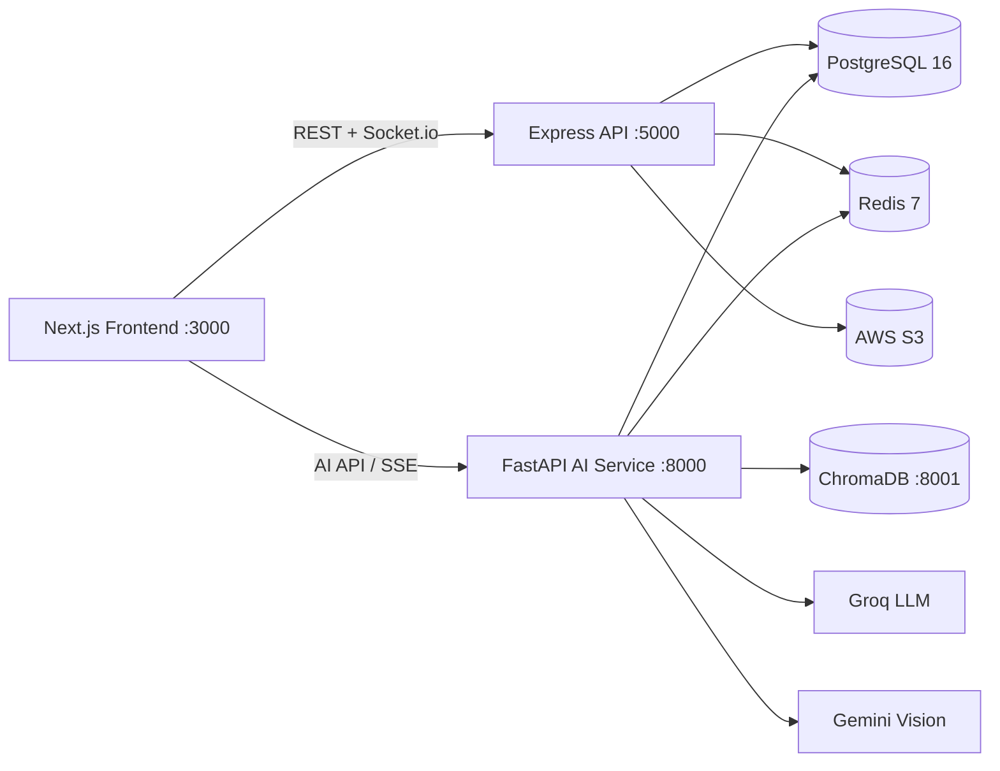

# CrimeNetX 🕵️

> **AI-Powered Criminal Network Analysis & Investigation Intelligence Platform**

> **Smart India Hackathon 2026 · Problem Statement SIH26189**

CrimeNetX is an investigative intelligence platform designed to transform heterogeneous crime data such as FIRs, CDRs, bank transactions, CCTV evidence and historical case records into structured, evidence-backed network intelligence.

The platform combines NLP, graph analytics, machine learning, multimodal AI and multi-agent orchestration to help investigators discover relationships, identify important network entities, detect suspicious patterns and generate investigation-ready intelligence.

> **Disclaimer:** CrimeNetX uses fabricated/mock data for development and demonstration. It does not contain or reference real individuals or real criminal cases.

---

# 📌 Problem Statement Mapping

| SIH26189 Requirement | CrimeNetX Implementation |
|---|---|
| Ingest unstructured crime records | FIR PDFs, CDR CSVs, bank statements, photographs, CCTV and historical records |
| Entity extraction from narratives | spaCy NER → regex extraction → Groq LLM contextual extraction |
| Link analysis / network discovery | NetworkX graph + PageRank, Betweenness, Degree and Eigenvector centrality |
| Identify key influencers / kingpins | Composite Kingpin Score (0–100) + KINGPIN / BROKER / EXECUTOR roles |
| Detect suspicious patterns | Isolation Forest, DBSCAN and financial layering detection |
| Cross-case serial offender detection | ChromaDB semantic search + Modus Operandi fingerprinting |
| Actionable intelligence outputs | Automated investigation dossier PDF with evidence/hash information |

---

# ✨ Key Features

### 1. Ghost Link Predictor

Predicts potentially hidden relationships between entities using graph-based algorithms such as:

- Jaccard similarity
- Common Neighbors
- Adamic-Adar

Investigators can review and accept/reject predicted links.

### 2. Time-Machine Network Playback

Allows investigators to examine how a criminal network evolves over time.

The network can be scrubbed from the beginning of the case toward the latest available evidence.

### 3. Multi-Case Cross-Reference

Uses ChromaDB semantic search to compare a case against historical FIR/case data and surface potentially related cases.

### 4. Modus Operandi Fingerprinting

Extracts MO characteristics from cases and compares them to historical cases to identify potentially similar patterns.

### 5. Multimodal CCTV Matcher

Uses Gemini Vision to compare CCTV images against available suspect imagery.

### 6. Money-Flow Tracer

Traces financial relationships through transaction networks.

Long multi-hop transaction paths can be flagged as potential layering patterns.

### 7. Automated Investigation Dossier

Generates an investigation dossier PDF containing structured intelligence and evidence/hash information.

### 8. LangGraph Multi-Agent Supervisor

Uses a multi-agent architecture to coordinate investigation analysis and stream progress through SSE.

### 9. FIR NLP Extraction

FIR text can be processed through a multi-layer extraction pipeline:

```text
FIR Text
   ↓
spaCy NER
   ↓
Regex Extraction
   ↓
Groq LLM Contextual Extraction
   ↓
Entities + Relationships
````

Entities can include:

* Persons
* Locations
* Phone numbers
* Vehicles
* Organizations
* Bank accounts
* Dates
* Aliases

---

# 🏗️ Architecture



---

# 🧰 Technology Stack

| Layer             | Technologies                                                                                                 |
| ----------------- | ------------------------------------------------------------------------------------------------------------ |
| Frontend          | Next.js 14, TypeScript, Tailwind CSS, shadcn/ui, React Flow, Recharts, Leaflet, Zustand, NextAuth, Socket.io |
| Backend API       | Node.js, Express, TypeScript, Prisma, Socket.io                                                              |
| AI / ML           | FastAPI, Python 3.11, LangGraph, LangChain, Groq, Gemini Vision, spaCy, NetworkX, scikit-learn, pandas       |
| Vector Search     | ChromaDB                                                                                                     |
| Database          | PostgreSQL 16                                                                                                |
| Cache / Messaging | Redis 7                                                                                                      |
| Storage           | AWS S3 / local demo storage                                                                                  |
| Authentication    | JWT + refresh tokens + RBAC                                                                                  |
| Infrastructure    | Docker + Docker Compose                                                                                      |

---

# 📋 Prerequisites

For the recommended setup, install:

* Git
* Docker Desktop

Make sure **Docker Desktop is running** before starting CrimeNetX.

### Optional

Node.js 20+ and Python 3.11+ are only required if you want to run individual services outside Docker.

You **do not need to separately install**:

* PostgreSQL
* Redis
* ChromaDB

These are already configured as Docker services.

---

# 🚀 Quick Start — Recommended Docker Setup

## 1. Clone the repository

```bash
git clone https://github.com/Prayag-Srivastava/CrimeNetX.git
cd CrimeNetX
```

---

## 2. Create environment files

The real `.env` files are intentionally **not committed to GitHub** because they contain secrets.

Copy the provided templates.

### PowerShell

```powershell
Copy-Item frontend\.env.local.example frontend\.env.local
Copy-Item backend-node\.env.example backend-node\.env
Copy-Item backend-ai\.env.example backend-ai\.env
```

### Linux / macOS

```bash
cp frontend/.env.local.example frontend/.env.local
cp backend-node/.env.example backend-node/.env
cp backend-ai/.env.example backend-ai/.env
```

Then open the three files and fill in the required environment variables.

---

# 🔐 Environment Variables

## Groq

Groq is used for text-based LLM reasoning and contextual extraction.

Create an API key and configure:

```env
GROQ_API_KEY=your_groq_api_key
```

inside:

```text
backend-ai/.env
```

---

## Google Gemini

Gemini is used for vision-related functionality such as CCTV/image analysis.

Configure:

```env
GEMINI_API_KEY=your_gemini_api_key
```

inside:

```text
backend-ai/.env
```

---

## AWS S3

AWS S3 is used for evidence/document storage when S3 mode is enabled.

Configure the AWS credentials and bucket information required by the provided `.env.example` files.

For local/demo development, the project also contains a local upload fallback.

---

## PostgreSQL

The recommended setup uses the PostgreSQL container provided by Docker Compose.

You do **not** need to install PostgreSQL separately.

---

## Redis

Redis is also provided by Docker Compose.

You do **not** need to install Redis separately.

---

# 🐳 3. Start the Project

From the root `CrimeNetX` directory:

```powershell
docker compose up --build
```

This starts the complete CrimeNetX stack.

Expected services:

```text
Frontend       → http://localhost:3000
Node Backend   → http://localhost:5000
AI Backend     → http://localhost:8000
PostgreSQL     → localhost:5432
Redis          → localhost:6379
ChromaDB       → localhost:8001
```

The first build may take several minutes because Docker needs to download dependencies and build the application images.

---

# 🗄️ 4. Database Setup

After the containers are running, apply the Prisma migrations:

```powershell
docker compose exec backend-node npx prisma migrate deploy
```

Then seed the database:

```powershell
docker compose exec backend-node npx prisma db seed
```

---

# 📊 5. Generate Mock Historical Data

CrimeNetX contains fabricated historical data for demonstration and testing.

Generate it with:

```powershell
docker compose exec backend-ai python -m data.generate_mock_data
```

This data is used by features such as:

* CCTNS simulation
* Cross-case analysis
* Historical case matching
* MO fingerprinting
* Network analysis

> This is simulated data and is **not real CCTNS data**.

---

# 🌐 6. Open the Application

Frontend:

```text
http://localhost:3000
```

FastAPI interactive documentation:

```text
http://localhost:8000/docs
```

---

# 👤 Test Accounts

The database seed creates test accounts.

| Role         | Email                           |
| ------------ | ------------------------------- |
| Investigator | `investigator@crimenetx.gov.in` |
| DSP          | `dsp@crimenetx.gov.in`          |
| SP           | `sp@crimenetx.gov.in`           |
| DGP          | `dgp@crimenetx.gov.in`          |

Password:

```text
Test@1234
```

Different roles have different access levels through RBAC.

---

# 🧪 Main Demonstration Flows

The following are the main implemented flows intended for demonstration/testing.

## FIR → NLP

```text
Upload FIR
   ↓
Evidence registration
   ↓
SHA-256 hash
   ↓
FIR text extraction
   ↓
NLP entity extraction
   ↓
Entity + relationship output
```

---

## CCTNS Simulation

The current development environment simulates an incoming CCTNS feed using fabricated historical case data.

```text
Mock historical case data
          ↓
CCTNS simulation
          ↓
Node backend
          ↓
Case creation
          ↓
Entity ingestion
          ↓
CrimeNetX case database
```

In a real deployment, the mock data source would be replaced by the authorized CCTNS integration/API/event stream.

---

## CDR Analysis

CDR CSV files can be processed to extract:

* Phone numbers
* Calling relationships
* Call duration
* Cell tower information
* IMEI information

These relationships can then contribute to network analysis.

---

## Bank Transaction Analysis

Bank CSV files can be processed to identify:

* Accounts
* Transaction relationships
* Transaction amounts
* Transaction paths
* Potential layering patterns

---

## Network Analysis

CrimeNetX constructs a graph from relationships between entities.

The graph analysis includes:

```text
PageRank
Betweenness Centrality
Degree Centrality
Eigenvector Centrality
        ↓
Composite Kingpin Score
        ↓
KINGPIN / BROKER / EXECUTOR
```

The score represents the **importance/centrality of an entity within the observed network**, not whether the person is guilty of a crime.

---

# 🔌 API Overview

## Node Backend

Runs on:

```text
http://localhost:5000
```

Main API areas:

```text
/api/auth
/api/cases
/api/suspects
/api/evidence
/api/network
/api/alerts
/api/analytics
/api/dossier
```

---

## AI Backend

Runs on:

```text
http://localhost:8000
```

Main API areas:

```text
/api/nlp/*
/api/graph/*
/api/vision/*
/api/vector/*
/api/financial/*
/api/agents/*
/api/dossier/*
```

Interactive API documentation:

```text
http://localhost:8000/docs
```

---

# 📁 Repository Structure

```text
CrimeNetX/
│
├── docker-compose.yml
│
├── frontend/
│   └── Next.js application
│
├── backend-node/
│   ├── prisma/
│   ├── src/
│   └── data/
│
├── backend-ai/
│   ├── app/
│   │   ├── agents/
│   │   ├── llm/
│   │   ├── models/
│   │   ├── routers/
│   │   ├── services/
│   │   └── utils/
│   └── data/
│
├── shared/
│   └── types/
│
└── docs/
    └── api-collection.json
```

---

# 🧠 AI / ML Components

## NLP

```text
spaCy
+
Regex extraction
+
Groq LLM
```

Used for extracting entities and contextual relationships from FIR narratives.

---

## Graph Intelligence

NetworkX is used for:

* Graph construction
* PageRank
* Betweenness
* Degree
* Eigenvector centrality
* Link prediction

---

## Machine Learning

scikit-learn is used for:

* Isolation Forest
* DBSCAN
* Similarity analysis

---

## Vector Search

ChromaDB is used for semantic retrieval across historical case information.

---

## Multi-Agent Analysis

LangGraph coordinates specialized agents including:

* Entity analysis
* Pattern analysis
* Kingpin/network analysis
* Supervisor orchestration

---

# 🛠️ Troubleshooting

## Check container status

```powershell
docker compose ps
```

---

## Frontend logs

```powershell
docker compose logs frontend --tail=100
```

---

## Node backend logs

```powershell
docker compose logs backend-node --tail=100
```

---

## AI backend logs

```powershell
docker compose logs backend-ai --tail=100
```

---

## Restart the project

```powershell
docker compose down
docker compose up --build
```

---

## Rebuild without cache

If an old Docker build appears to be causing issues:

```powershell
docker compose build --no-cache
docker compose up
```

---

# 💻 Local Development Without Docker

Docker is the recommended setup for the team.

If you specifically need to run services individually, use the following.

## Backend Node

```bash
cd backend-node
npm install
npx prisma migrate deploy
npx prisma db seed
npm run dev
```

---

## Backend AI

```bash
cd backend-ai

python -m venv .venv
```

Activate the environment.

### Windows

```powershell
.venv\Scripts\Activate.ps1
```

### Linux / macOS

```bash
source .venv/bin/activate
```

Install dependencies:

```bash
pip install -r requirements.txt
```

Install spaCy model:

```bash
python -m spacy download en_core_web_sm
```

Generate mock data:

```bash
python -m data.generate_mock_data
```

Run the AI service:

```bash
uvicorn main:app --reload --port 8000
```

---

## Frontend

```bash
cd frontend
npm install
npm run dev
```

Frontend:

```text
http://localhost:3000
```

---

# 🔄 Git Workflow

This is a shared team repository.

Before starting work:

```powershell
git pull
```

After making changes:

```powershell
git status
git add .
git commit -m "Describe your changes"
git push
```

For example:

```powershell
git add .
git commit -m "Add FIR NLP extraction UI"
git push
```

---

# ⚠️ Important Git / Security Rules

**Never commit API keys or secrets.**

Do not commit:

```text
.env
.env.local
```

The repository already contains `.gitignore` rules for these files.

Use the example files instead:

```text
.env.example
frontend/.env.local.example
backend-node/.env.example
backend-ai/.env.example
```

Never paste API keys into GitHub, commits, screenshots or public documentation.

---

# 👥 Team Development

CrimeNetX is maintained as a **single repository** containing the complete system.

```text
One GitHub Repository
        │
        ├── Frontend
        ├── Node Backend
        ├── AI Backend
        ├── Shared Types
        ├── Docker Configuration
        └── Documentation
```

This allows the complete application to be cloned and developed together.

For larger changes, create a feature branch:

```powershell
git checkout -b feature/your-feature-name
```

After completing the work:

```powershell
git add .
git commit -m "Implement your feature"
git push -u origin feature/your-feature-name
```

Then create a Pull Request on GitHub.

---

# 📌 Current Implementation

CrimeNetX currently includes:

* [x] Multi-source evidence ingestion
* [x] FIR upload
* [x] SHA-256 evidence hashing
* [x] FIR NLP entity extraction
* [x] spaCy NER
* [x] Regex entity extraction
* [x] Groq contextual extraction
* [x] CDR extraction
* [x] Bank transaction extraction
* [x] Interactive criminal network graph
* [x] PageRank
* [x] Betweenness centrality
* [x] Degree centrality
* [x] Eigenvector centrality
* [x] Composite Kingpin Score
* [x] Role classification
* [x] Ghost Link Prediction
* [x] Time-Machine network playback
* [x] Cross-case semantic search
* [x] MO fingerprinting
* [x] Gemini Vision integration
* [x] Financial money-flow tracing
* [x] Layering detection
* [x] Isolation Forest anomaly detection
* [x] DBSCAN clustering
* [x] Real-time WebSocket alerts
* [x] Role-based dashboards
* [x] RBAC
* [x] Automated investigation dossier generation
* [x] LangGraph multi-agent supervisor
* [x] SSE progress streaming
* [x] JWT authentication
* [x] Audit logging
* [x] Rate limiting
* [x] Structured logging
* [x] CCTNS integration simulation using fabricated historical data

---

# 🔮 CCTNS Integration Note

The current CCTNS functionality is a **development simulation**.

Instead of connecting to an actual CCTNS/NCRB gateway, the application currently reads fabricated historical case data and processes it through the same general ingestion path.

Conceptually:

```text
CURRENT DEMO

historical_cases.json
        ↓
CCTNS Simulation
        ↓
CrimeNetX Backend
        ↓
PostgreSQL
```

A production integration would replace the simulated source with an authorized CCTNS integration:

```text
ACTUAL DEPLOYMENT

CCTNS / Authorized Gateway
        ↓
Secure Integration Layer
        ↓
CrimeNetX Backend
        ↓
Validation + Audit
        ↓
PostgreSQL / AI Processing
```

---

# 📸 Screenshots

Screenshots can be added under:

```text
docs/screenshots/
```

and referenced here as the project UI is finalized.

---

# 📄 License

MIT License.

This project is developed for **Smart India Hackathon 2026 — SIH26189**.

All demonstration/mock data is fabricated and intended only for development, testing and hackathon presentation.

---

# 🧠 CrimeNetX

**Turning fragmented crime data into connected investigative intelligence.**


