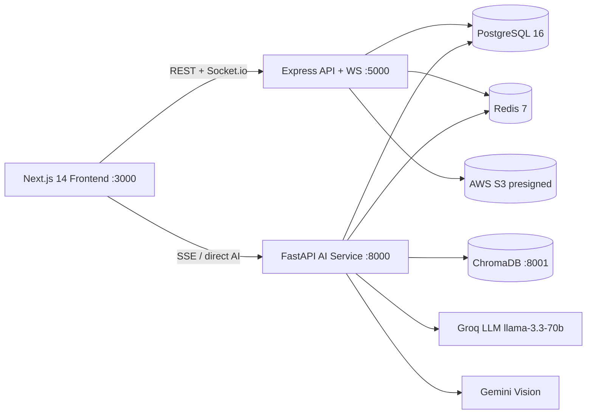

# CrimeNetX 🕵️ — AI-Powered Criminal Network Analysis System

> **Smart India Hackathon 2026 · Problem Statement SIH26189**
> An investigative intelligence platform for the Ministry of Home Affairs that turns raw, unstructured crime data (FIRs, CDRs, bank statements, CCTV, social media) into court-admissible network intelligence.

---

## 📌 PS Mapping (SIH26189)

| Problem statement requirement | CrimeNetX implementation |
|---|---|
| Ingest unstructured crime records | Multi-source ingestion: FIR PDFs (PyMuPDF), CDR CSVs (pandas), bank statements, photos, CCTV, social text |
| Entity extraction from narratives | 3-layer NLP pipeline: spaCy NER → regex (phones, vehicle plates, accounts) → Groq LLM contextual extraction |
| Link analysis / network discovery | NetworkX directed graph + PageRank / Betweenness / Degree / Eigenvector centrality |
| Identify key influencers / kingpins | Composite **Kingpin Score (0–100)** → roles KINGPIN / BROKER / EXECUTOR |
| Detect suspicious patterns | Isolation Forest anomalies + DBSCAN clustering + money-laundering layering detection |
| Cross-case serial offender detection | ChromaDB semantic search + Modus Operandi fingerprinting with cosine similarity |
| Actionable intelligence outputs | Auto-generated 20-page investigation dossier PDF (reportlab) |

## 🧩 Distinguishing Features

1. **Ghost Link Predictor** — Jaccard / Common Neighbors / Adamic-Adar predicts hidden connections (investigators accept/reject).
2. **Time-Machine Playback** — slider scrubs the network evolution from case start → today; kingpin scores over time.
3. **Multi-Case Cross-Reference Engine** — ChromaDB semantic search across historical FIRs, top-10 linked cases with relevance scores.
4. **Modus Operandi Fingerprint** — Groq-extracted MO features embedded & matched for serial offenders.
5. **Multimodal CCTV Matcher** — Gemini 1.5 Flash vision compares CCTV screenshots against the suspect photo gallery.
6. **Money-Flow Tracer** — weighted shortest-path money trails; >3 hops flags layering.
7. **Auto Investigation Dossier** — court-ready 20-page PDF with hash tamper-evidence, uploaded to S3.
8. **LangGraph Multi-Agent Supervisor** — streaming agent orchestration over SSE.

## 🏗️ Architecture



## 🧰 Tech Stack

| Layer | Technology |
|---|---|
| Frontend | Next.js 14 (App Router, TS strict), Tailwind, ShadCN UI, React Flow, Recharts, Leaflet, Zustand, NextAuth, Socket.io-client |
| REST + WS API | Node.js Express (TypeScript), Prisma ORM, Socket.io, JWT + refresh tokens |
| AI / ML | FastAPI (Python 3.11), LangGraph, LangChain, Groq SDK, Gemini Vision, spaCy, NetworkX, scikit-learn, pandas, ChromaDB |
| Data | PostgreSQL 16, Redis 7 (Upstash-compatible), ChromaDB (persistent) |
| Infra | Docker + docker-compose, AWS S3 presigned uploads, Helmet, winston/loguru logging |

## 🚀 Prerequisites

- Node.js **20+** · npm 10+
- Python **3.11+** (3.10–3.13 works)
- Docker + Docker Compose v2
- API keys: [Groq](https://console.groq.com), [Gemini](https://aistudio.google.com/apikey), [AWS](https://console.aws.amazon.com) (S3)
- `poppler` optional (PDF rendering for graph screenshots)

## ⚙️ Setup

### 1. Clone & install

```bash
git clone <your-repo-url> crimenetx && cd crimenetx
```

### 2. Environment variables

Create the three `.env` files (templates already shipped blank — see **[Environment Variables Setup](#environment-variables-setup)** for the full guide and where each key comes from):

```bash
cp frontend/.env.local.example frontend/.env.local     # then fill
cp backend-node/.env.example backend-node/.env         # then fill
cp backend-ai/.env.example backend-ai/.env             # then fill
```

### 3. Run everything

```bash
docker compose up --build
```

First boot runs Prisma migrations automatically (`prisma migrate deploy`) and seeds data:

```bash
docker compose exec backend-node npx prisma db seed
docker compose exec backend-ai python -m data.generate_mock_data
```

### 4. Local (no Docker) development

```bash
# Terminal 1 — backend-node
cd backend-node && npm i && npx prisma migrate deploy && npx prisma db seed && npm run dev

# Terminal 2 — backend-ai
cd backend-ai && python -m venv .venv && source .venv/bin/activate
pip install -r requirements.txt
python -m spacy download en_core_web_sm
python -m data.generate_mock_data
uvicorn main:app --reload --port 8000

# Terminal 3 — frontend
cd frontend && npm i && npm run dev   # http://localhost:3000
```

Seed logins (all password `Test@1234`):

| Role | Email |
|---|---|
| Investigator | `investigator@crimenetx.gov.in` |
| DSP | `dsp@crimenetx.gov.in` |
| SP | `sp@crimenetx.gov.in` |
| DGP | `dgp@crimenetx.gov.in` |

## 🗂️ Repository Layout

```
crimenetx/
├── docker-compose.yml        # postgres, redis, chromadb, node, ai, frontend
├── frontend/                 # Next.js 14 app (App Router, shadcn, React Flow)
├── backend-node/             # Express REST + Socket.io + Prisma + RBAC
├── backend-ai/               # FastAPI AI service (NLP, GraphML, agents, dossier)
├── shared/types/             # Shared TypeScript contracts
└── docs/api-collection.json  # Postman/Bruno collection
```

## 🔌 API Overview

- **Node backend** (`:5000/api`) — auth, cases, suspects, evidence, network, alerts, analytics, dossier.
- **AI backend** (`:8000/api`) — `/nlp/*`, `/graph/*`, `/vision/*`, `/vector/*`, `/financial/*`, `/agents/analyze-case/:caseId` (SSE), `/dossier/*`.

Full interactive docs: FastAPI → `http://localhost:8000/docs`, and the bundled Postman collection in [`docs/api-collection.json`](docs/api-collection.json).

## ✨ Feature List

- [x] Multi-source ingestion (FIR/CDR/Bank/Photo/CCTV) with S3 presigned URLs + SHA-256 chain-of-custody hashes
- [x] 3-layer NLP entity extraction (spaCy → regex → Groq) — Pydantic validated
- [x] Interactive network graph (React Flow, role-colored, animated money-flow edges, minimap)
- [x] 4 centrality algorithms → composite Kingpin Score → role classification
- [x] Ghost Link predictor, Time-Machine playback, Cross-reference engine, MO fingerprinting
- [x] CCTV suspect matcher (Gemini Vision), Financial money-flow tracer with layering detection
- [x] Isolation Forest + DBSCAN suspicious pattern detection with real-time WS alerts
- [x] Role-based dashboards (Investigator / DSP / SP / DGP) with RBAC guard
- [x] Auto-generated 20-page investigation dossier PDF with tamper hash
- [x] LangGraph multi-agent supervisor with SSE streaming progress
- [x] JWT + refresh tokens, audit logging, helmet, rate limiting, structured logging

*(Screenshots placeholder — add `docs/screenshots/*.png`)*

## 👥 Team

**Team <Your-Team-Name>** — *Smart India Hackathon 2026 · SIH26189*
*Members:* <add names & colleges here>

## 📄 License

[MIT](LICENSE) — For hackathon evaluation purposes. All mock data is fabricated; no real individuals or cases are referenced.

---

## Environment Variables Setup

### Groq (primary LLM — text & reasoning)
1. Go to **https://console.groq.com** → *Sign up / Log in*.
2. *API Keys* → *Create API Key* → name it `crimenetx`.
3. Copy the key (starts with `gsk_…`) into `backend-ai/.env` as `GROQ_API_KEY=gsk_xxxxx`.
4. Leave `GROQ_MODEL=groq/compound-mini` (free tier).

### Google Gemini (vision only)
1. Go to **https://aistudio.google.com/apikey** → *Create API Key*.
2. Copy `AIza…` key into `backend-ai/.env` as `GEMINI_API_KEY=AIza…`.

### AWS S3 (evidence storage)
1. **https://console.aws.amazon.com/iam** → *Users* → *Create user* (programmatic access).
2. Attach `AmazonS3FullAccess` policy, copy `AWS_ACCESS_KEY_ID` / `AWS_SECRET_ACCESS_KEY`.
3. **https://console.aws.amazon.com/s3** → *Create bucket* (`ap-south-1`), set region/bucket name in all three `.env` files.

### PostgreSQL / Redis
- Local dev: use the docker-compose `postgres` / `redis` services — credentials `crimenetx`/`crimenetx` as shown in `.env.example`.
- Or bring your own (or Upstash Redis) and paste the connection strings.

### Frontend URLs
Set `NEXT_PUBLIC_API_URL`, `NEXT_PUBLIC_AI_API_URL`, `NEXT_PUBLIC_SOCKET_URL`, `NEXTAUTH_URL`, `NEXTAUTH_SECRET` in `frontend/.env.local` (see `.env.example`).

---

*Built with 🧠 Groq reasoning, 📊 NetworkX graph intelligence, and 🚔 a mission to make investigations faster.*
